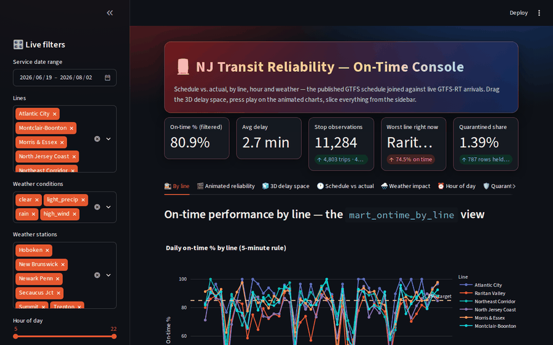
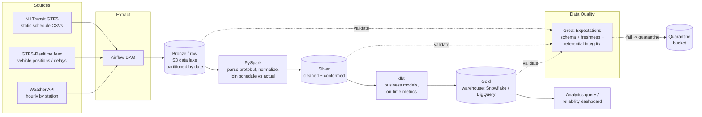

# NJ Transit Reliability Pipeline

An end-to-end data pipeline that measures how reliably NJ Transit trains run — and whether weather explains the delays. It ingests static schedule data, live vehicle positions, and hourly weather; lands everything in a partitioned data lake; models on-time performance with Spark and dbt; loads the results into a cloud warehouse; and runs it all on a schedule with Airflow.

The thing that makes this repo different from most data-pipeline portfolios: **every hop is validated.** Bad data gets quarantined, not silently loaded. That data-quality layer is treated as a first-class part of the pipeline, not an afterthought.



## The console

The pipeline's serving layer is an interactive reliability console
(`app/dashboard.py`, Streamlit + Plotly) that runs over the gold marts —
schedule vs. actual, by line, hour and weather:

- **Live sidebar filters** — service-date range, lines, weather conditions,
  weather stations, hour-of-day window, direction and a late-trains-only
  toggle; every chart, table and KPI re-renders instantly.
- **KPI cards with deltas** — filtered on-time % vs. the prior equal-length
  period, average delay, stop observations, the worst line right now, and
  the quarantined share of rows held back by the quality gates.
- **Animated charts** — Plotly `animation_frame` views: daily on-time % by
  line and a cumulative delay race you can play, day by day.
- **3D delay space** — a rotatable `Scatter3d` of every stop observation in
  hour × temperature × delay space, and a line × hour **on-time surface**
  terrain (drag to orbit, scroll to zoom).
- **The pipeline's own rules, on screen** — on-time means delay ≤ 300s
  (`ON_TIME_THRESHOLD_SECONDS`), weather buckets follow
  `fct_stop_performance` exactly (rain / light precip / high wind / clear),
  and the quarantine tab shows the Great Expectations ledger per medallion
  layer, with storm-day spikes.
- **Dark UI** — gradient hero header, glass KPI cards and a custom dark
  theme (`.streamlit/config.toml` + inline CSS).

The console runs standalone from the repo — demo data is generated
deterministically from the pipeline's own schemas (silver stop-performance
grain, the two gold marts), so it needs no S3, Snowflake or live feed:
`streamlit run app/dashboard.py`.

---

## Why this project exists

Public transit data is a good stress test for data engineering because it's genuinely messy: the schedule lives in flat CSV files, the real-time feed arrives as binary protobuf on a timer, and joining "what was supposed to happen" against "what actually happened" surfaces every data-quality problem you'd hit in a production warehouse. This pipeline turns those raw feeds into a clean, queryable answer to a simple question:

> What percentage of trains ran on time, broken down by line, hour of day, and weather condition?

---

## Architecture



Data moves through a standard medallion layout — **bronze** (raw, immutable), **silver** (cleaned and conformed), **gold** (business-ready marts in the warehouse). Great Expectations sits beside every layer transition; if a batch fails its checks, it's routed to a quarantine location and the downstream tasks are skipped rather than fed bad data.

---

## Tech stack

| Layer | Tooling |
|---|---|
| Orchestration | Apache Airflow |
| Ingestion | Python (requests, `gtfs-realtime-bindings`) |
| Data lake | Amazon S3 (bronze/silver, date-partitioned) |
| Processing | PySpark |
| Transformation / modeling | dbt |
| Warehouse | Snowflake *(or BigQuery — see notes)* |
| Data quality | Great Expectations |
| Testing | pytest, dbt tests |
| Serving | Streamlit + Plotly (reliability console) |
| CI | GitHub Actions |
| Env / runtime | Linux, Docker, Git |

---

## Data sources

1. **NJ Transit GTFS (static)** — the published schedule: routes, trips, stops, stop times. Flat CSVs inside a periodically-updated zip. This is the "supposed to happen" side.
2. **GTFS-Realtime** — live trip updates and vehicle positions, served as Protocol Buffers and refreshed on a short interval. This is the "actually happened" side. Delay is derived by joining realtime arrivals against the static schedule.
3. **Weather API** — hourly conditions (temperature, precipitation, wind) keyed to station coordinates, so delays can be correlated with weather.

Having three sources of different shapes (CSV, protobuf, JSON API) is deliberate — it's what makes the extract and validation stages realistic rather than a single `read_csv`.

---

## Pipeline stages

**Extract** → An Airflow DAG pulls the realtime feed on a schedule, refreshes the static GTFS when it changes, and fetches weather for the active stations. Raw payloads land in the bronze S3 prefix, partitioned by ingest date, untouched.

**Transform (Spark)** → PySpark parses the realtime protobuf, normalizes timestamps and IDs, joins scheduled vs. actual stop times, and computes delay minutes and an on-time flag per trip-stop. Output is written to the silver layer.

**Model (dbt)** → dbt builds the conformed dimensions (line, station, date/hour, weather bucket) and the fact table of stop-level performance, then rolls up gold marts: on-time percentage by line, by hour, and by weather condition.

**Load** → Gold marts land in the warehouse (Snowflake or BigQuery), ready for querying or a dashboard.

---

## Data quality (the part most pipelines skip)

Great Expectations suites run at each layer boundary. When an expectation fails, the batch is quarantined and downstream Airflow tasks are marked skipped, so a bad feed can never silently corrupt the gold marts.

- **On ingest (bronze):** schema contracts — expected columns, types, non-null keys — plus a **freshness check** that fails if the realtime feed is stale (a common real-world failure where the feed goes quiet but the DAG keeps "succeeding").
- **On transform (silver):** **referential integrity** between realtime records and the static schedule (every realtime trip must map to a known scheduled trip), and range/anomaly bounds on delay values to catch clock-skew and parsing bugs.
- **On load (gold):** row-count and uniqueness checks on the marts, and reconciliation that aggregates tie out against the silver layer.

dbt tests (`unique`, `not_null`, `relationships`, accepted-value tests) run alongside these as a second layer of coverage on the modeled tables.

---

## Repository structure

```
nj-transit-reliability-pipeline/
├── dags/
│   └── reliability_pipeline_dag.py     # Airflow DAG: extract → validate → transform → load
├── ingestion/
│   ├── gtfs_static.py                  # static schedule download + unzip
│   ├── gtfs_realtime.py                # protobuf pull + parse
│   └── weather.py                      # weather API client
├── spark/
│   └── build_silver.py                 # PySpark: normalize + join schedule vs actual
├── dbt/
│   ├── models/
│   │   ├── staging/
│   │   ├── marts/
│   │   │   ├── fct_stop_performance.sql
│   │   │   ├── mart_ontime_by_line.sql
│   │   │   └── mart_ontime_by_weather.sql
│   │   └── schema.yml                  # dbt tests live here
│   └── dbt_project.yml
├── quality/
│   └── expectations/                   # Great Expectations suites per layer
├── app/
│   └── dashboard.py                    # Streamlit + Plotly reliability console
├── tests/
│   └── ...                             # pytest unit tests for ingestion + transforms
├── .github/workflows/
│   └── ci.yml                          # lint + pytest + dbt tests on every push
├── docker-compose.yml                  # local Airflow + Spark
└── README.md
```

---

## Quickstart (local)

Prerequisites: Docker, Python 3.11+, a warehouse account (Snowflake or a GCP project for BigQuery), and an AWS account for S3.

```bash
# 1. Clone and configure
git clone https://github.com/<you>/nj-transit-reliability-pipeline.git
cd nj-transit-reliability-pipeline
cp .env.example .env        # add S3 bucket, warehouse creds, weather API key

# 2. Bring up Airflow + Spark locally
docker compose up -d

# 3. Trigger the pipeline
#    Open the Airflow UI (localhost:8080) and run `reliability_pipeline_dag`,
#    or from the CLI:
docker compose exec airflow airflow dags trigger reliability_pipeline_dag

# 4. Run the test + validation suite
pytest
cd dbt && dbt test
```

---

## Sample output

Once the gold marts are populated, the headline question answers in a single query:

```sql
select
    line_name,
    weather_condition,
    round(100.0 * sum(on_time_flag) / count(*), 1) as on_time_pct,
    count(*) as trips
from mart_ontime_by_weather
group by 1, 2
order by on_time_pct asc;
```

The reliability console (see *The console* above) renders exactly this cut
live — on-time % by line and weather condition, with the delay distribution
behind it — and the query alone tells the story: which lines degrade most
when it rains.

---

## Continuous integration

Every push runs a GitHub Actions workflow that lints the Python, runs `pytest` against the ingestion and transform logic, and executes `dbt test` against a seeded sample. The pipeline is designed so the data-quality gates are exercised in CI, not just in production — a bad transform fails the build.

---

## Roadmap and honest gaps

This is a batch pipeline by design — the realtime feed is polled on a schedule rather than streamed, which is the right complexity level for the problem and keeps the project finishable and reliable. Things I'd add next, roughly in order:

- Streaming ingestion (Kafka) for the realtime feed instead of scheduled polling.
- Incremental dbt models with snapshots for slowly-changing schedule data.
- A backfill utility to reconstruct historical reliability from archived feeds.
- Alerting on quarantined batches (Slack / email) via Airflow callbacks.

---

## License

MIT
